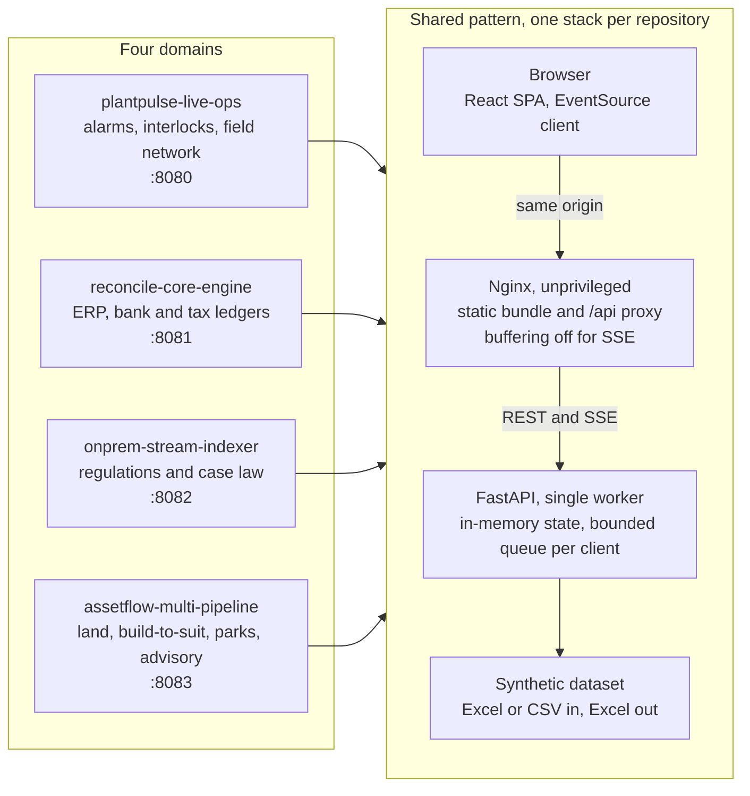

# Dario Gallardo

**On-premises operational intelligence, real-time SSE streaming and automated data reconciliation.**

I build systems for places where the data cannot leave the building: plant floors, finance
back offices, legal archives and engineering departments. The repositories below are
reference architectures. Each one is small enough to read in an afternoon, runs on a
laptop with no internet connection, and uses only synthetic data.

## Reference architectures

| System | Domain | What it shows | Port | Status |
| --- | --- | --- | --- | --- |
| [plantpulse-live-ops](https://github.com/d-gallardo-1/plantpulse-live-ops) | Industrial operations | Live alarm diagnostics, Cause & Effect matrix parsing from Excel, field network watchdog | 8080 | Published |
| reconcile-core-engine | Finance, bank and tax | Three-pass reconciliation of ERP, bank and tax sources with live progress and an Excel audit pack | 8081 | Pre-release |
| onprem-stream-indexer | Regulatory and case law | Per-tenant ingestion and full-text search that streams matching rulings as they are found, with live outcome analytics and an Excel report | 8082 | Pre-release |
| [assetflow-multi-pipeline](https://github.com/d-gallardo-1/assetflow-multi-pipeline) | Capital assets and infrastructure sites | Four-pipeline Kanban board with live sync, CSV ingestion with validation, soft-delete trash bin with retention, portfolio analytics | 8083 | Published |

Each system has its own port, so all four can run side by side on one machine.

## One pattern, four domains

The domains differ; the shape of the system does not. Every repository follows the same
deployment pattern, which is what makes them comparable.



## Design rules shared by every repository

- **Runs offline.** No CDN, no web fonts, no external API. The Content Security Policy
  allows only same-origin resources.
- **Live by default.** State changes reach the browser over Server-Sent Events. Every
  state event is a complete snapshot, so a client that connects late or reconnects is
  consistent again after one message.
- **Spreadsheets are a real interface.** Each system works with the files its users
  already have. Where it ingests an Excel workbook or a CSV file, the input is validated
  and the failing row and column are reported; results are exported to Excel.
- **Hardened containers.** Read-only root filesystem, all capabilities dropped,
  `no-new-privileges`, the backend never published to the host, the UI bound to
  `127.0.0.1`.
- **Synthetic data only.** Every station, counterparty, invoice, case and asset is
  invented. Nothing is connected to a real plant, bank, tax authority or court.
- **Honest scope.** Each README states what the demo does not do: no authentication,
  in-memory state, a single worker. The architecture notes say what a real deployment
  would need.
- **Readable code.** Orchestrator files plus modules of at most 200 lines, enforced in CI.

## Stack

Python 3.13 · FastAPI · Server-Sent Events · React 18 · TypeScript · Vite · Tailwind CSS ·
Nginx · Docker Compose · pytest · GitHub Actions

## Running any of them

```bash
git clone https://github.com/d-gallardo-1/plantpulse-live-ops.git
cd plantpulse-live-ops
docker compose up --build
```

Then open <http://127.0.0.1:8080>. Each repository also ships `run_local.ps1` and
`run_local.sh` for running without Docker.
